# IT architecture: PDB Swingbench Orchestrator

This document describes the application as built (v1, milestones M0–M6) from an IT-architecture point
of view: context, deployment, network and security, software components, data, runtime behaviour and
operations. Diagrams are [Mermaid](https://mermaid.js.org/) and render on GitHub. Design rationale and
parity notes with the original scripts are in [`ARCHITECTURE.md`](ARCHITECTURE.md); installation and
operation in [`INSTALL.md`](INSTALL.md) and [`OPERATIONS.md`](OPERATIONS.md).

**Contents**

1. [System context](#1-system-context)
2. [Deployment topologies](#2-deployment-topologies)
3. [Network, ports and trust zones](#3-network-ports-and-trust-zones)
4. [Logical components](#4-logical-components)
5. [Technology stack](#5-technology-stack)
6. [API surface](#6-api-surface)
7. [Data architecture](#7-data-architecture)
8. [Runtime: key scenarios](#8-runtime-key-scenarios)
9. [Process and concurrency model](#9-process-and-concurrency-model)
10. [Security architecture](#10-security-architecture)
11. [Resilience and recovery](#11-resilience-and-recovery)
12. [Build, packaging and deployment pipeline](#12-build-packaging-and-deployment-pipeline)
13. [Quality and test architecture](#13-quality-and-test-architecture)
14. [Constraints and known limits](#14-constraints-and-known-limits)

---

## 1. System context

Who uses the system and what it talks to.

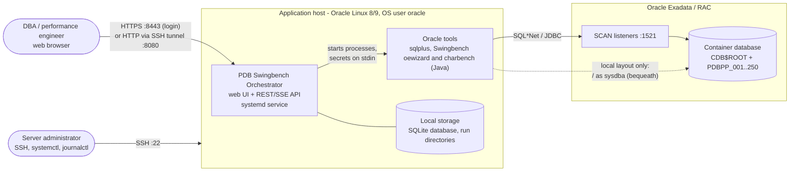

| Actor / system | Role |
|---|---|
| DBA | Plans and runs PDB creation, SOE loads, connection checks and workloads; monitors live; downloads results |
| Orchestrator | Validates input, generates the same SQL and command lines as the reference scripts, runs and supervises the tools, stores history |
| sqlplus | Privileged SQL (inventory, create/drop, GRANT) and SOE connection checks |
| oewizard / charbench | Swingbench schema load and workload, one Java process per PDB |
| Oracle RAC CDB | Target of all operations, reached through the SCAN listeners |
| Administrator | Installs the service, manages logins, backups and upgrades |

---

## 2. Deployment topologies

The profile setting **CDB connection** selects one of two layouts. Both run the same software.

### 2.1 Local layout: application on a database node

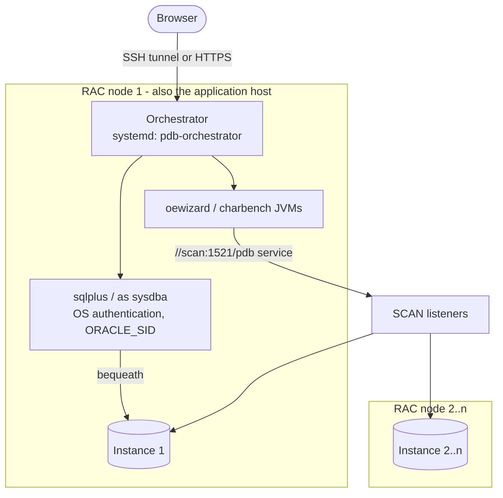

Needs on the node: the CDB's Oracle home, `ORACLE_SID`, Swingbench and Java. Downside: up to 250
charbench JVMs compete with the database being measured.

### 2.2 Remote layout: separate application server (recommended for large runs)

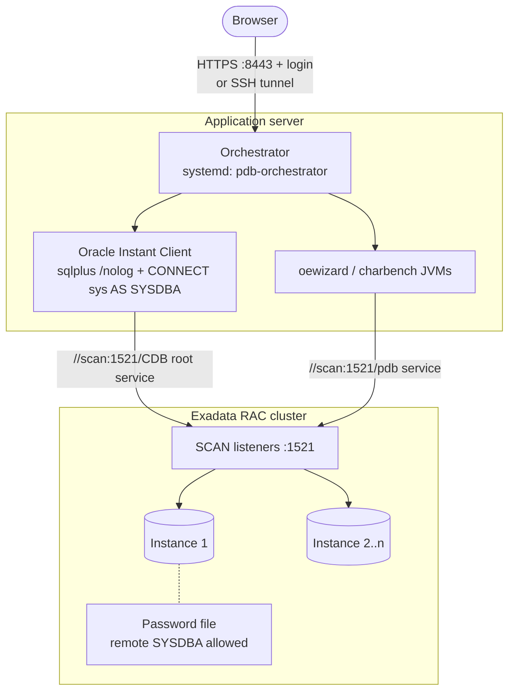

Needs: Instant Client with SQL*Plus, Swingbench and Java on the app server, TCP 1521 to the SCAN,
and the CDB root service name. The SYS password is entered once per browser session.

### 2.3 Inside the application host

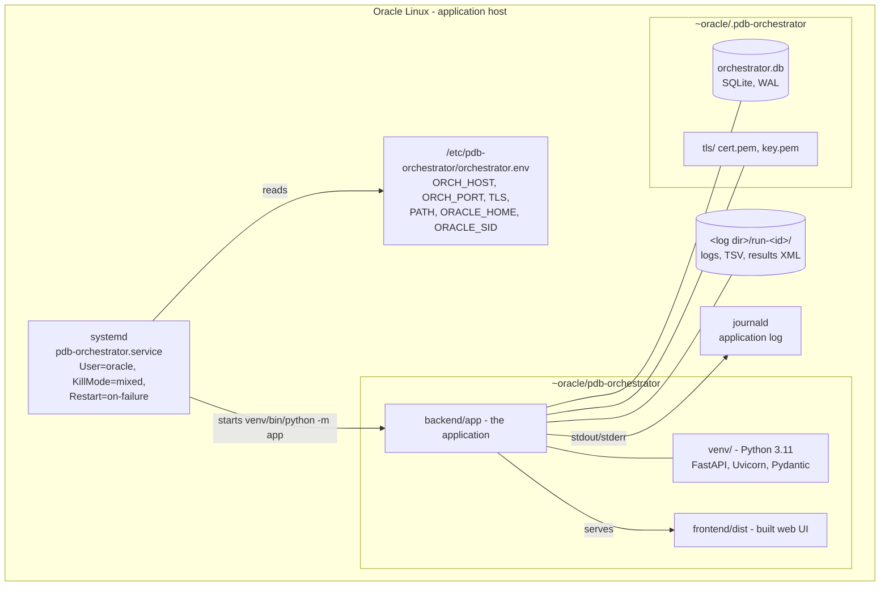

---

## 3. Network, ports and trust zones

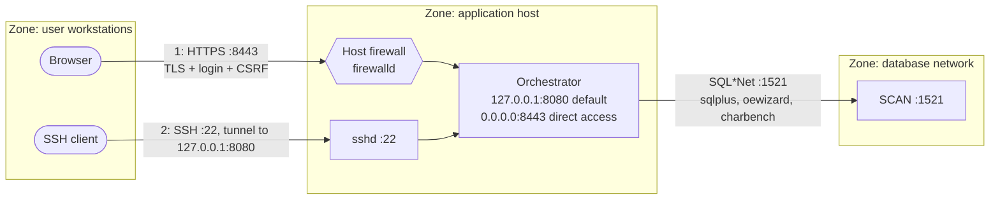

| Flow | Port | Protocol | Protection | When |
|---|---|---|---|---|
| Browser to app (direct) | 8443 (any `ORCH_PORT`) | HTTPS | TLS (own or self-signed certificate), login, CSRF token, Secure cookies | `ORCH_HOST=0.0.0.0` |
| Browser to app (tunnel) | 22, then 127.0.0.1:8080 | SSH + HTTP | SSH encryption and authentication; app only on loopback | default |
| Browser to app (proxy) | proxy port | HTTPS to proxy, HTTP to app | TLS at the proxy, login and CSRF at the app | `ORCH_TLS=off` |
| App to database | 1521 | Oracle Net | database authentication (SYS, SOE) | always (remote layout also for SYSDBA) |
| Live updates | same as browser | Server-Sent Events | same session cookie | run pages |

Binding rules enforced at start: a non-loopback address requires at least one login and switches
HTTPS on (unless `ORCH_TLS=off` for a TLS proxy); without a login the service refuses to start.

---

## 4. Logical components

### 4.1 Component view

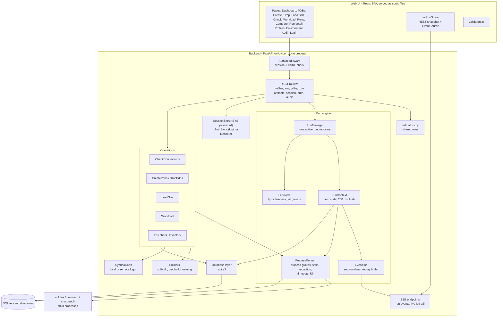

### 4.2 Responsibilities

| Component | Responsibility |
|---|---|
| Web UI | Forms with plan/dry run, inline validation, equivalent-command preview, live tile grid, drawers with log tails, history, compare, audit |
| Auth middleware | With login on: rejects API calls without a session (401) and state changes without the CSRF token (403) |
| Validators | One rule set for every field that reaches SQL or a command line; mirrored in the browser and tested with shared vectors |
| Operations | One class per run type: validate, `plan()` (dry run), `execute()`; same behaviour as the reference scripts |
| Builders | Generate SQL text and argument lists; golden tests compare them with the scripts' heredocs |
| SysdbaConn | Privileged logon: `/ as sysdba` or `CONNECT sys/"…"@//scan/service AS SYSDBA` plus a session marker check |
| RunManager / RunContext | One active run, item state machine, batched persistence and events, cancel, startup recovery |
| EventBus | Ordered events with sequence numbers, replay on reconnect, resync when too old |
| ProcessRunner | Starts every tool in its own session/process group, feeds secrets on stdin, redacts output into 0600 logs, enforces timeouts, kills groups |
| Leftovers | After a crash: finds recorded processes still alive (pid + start time or process group), kills them on request |
| SessionStore / AuthStore | In-memory SYS password per browser (1–24 h) and login sessions (8 h idle, 24 h max) |

---

## 5. Technology stack

```mermaid
flowchart LR
    subgraph Client
        R["React 19 + TypeScript"]
        TQ["TanStack Query,<br/>TanStack Virtual"]
        V["Vite build"]
    end
    subgraph Server
        PY["Python 3.11"]
        FA["FastAPI + Pydantic v2"]
        UV["Uvicorn (TLS)"]
        SQ["sqlite3 (stdlib), WAL"]
        AIO["asyncio subprocesses"]
    end
    subgraph Platform
        OL["Oracle Linux 8/9"]
        SD["systemd + journald"]
        OSSL["OpenSSL (self-signed cert)"]
        ORA["SQL*Plus / Instant Client"]
        SB["Swingbench + Java"]
    end
    Client -- "HTTPS, JSON, SSE" --> Server
    Server --> Platform
```

| Layer | Choice | Why |
|---|---|---|
| UI | React, TypeScript, TanStack Query/Virtual, plain CSS | Dense, keyboard-accessible UI that stays smooth with 250 live items |
| API | FastAPI, Pydantic, Uvicorn | Async I/O for hundreds of child processes and SSE streams in one process |
| Storage | SQLite (WAL) via stdlib | No extra server; single file to back up |
| Process control | asyncio, POSIX sessions and process groups | Reliable stop of sqlplus, oewizard, charbench and their Java children |
| Packaging | venv, offline wheel bundle, committed UI build | Installs on hosts without internet, npm or Node.js |
| Testing | pytest, vitest, Playwright, simulation stubs | Full behaviour testable without an Oracle database |

---

## 6. API surface

All endpoints are under `/api`. With login on, everything except `health`, `auth/state` and
`auth/login` needs a session; POST/PUT/DELETE also need the `X-CSRF-Token` header.

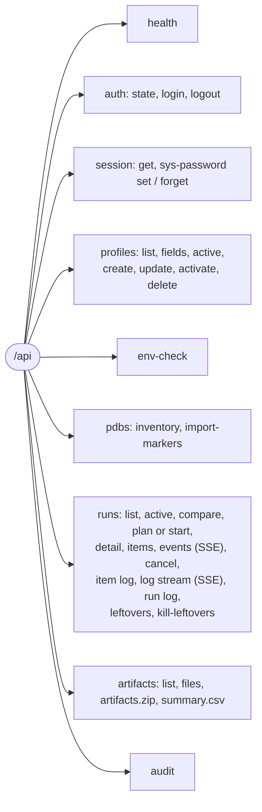

A run is started with `POST /api/runs {type, params, secrets, dry_run, retry_of}`; `type` is one of
`check`, `create`, `drop`, `load`, `workload`. With `dry_run` the same call returns the plan.

---

## 7. Data architecture

### 7.1 Data model (SQLite)

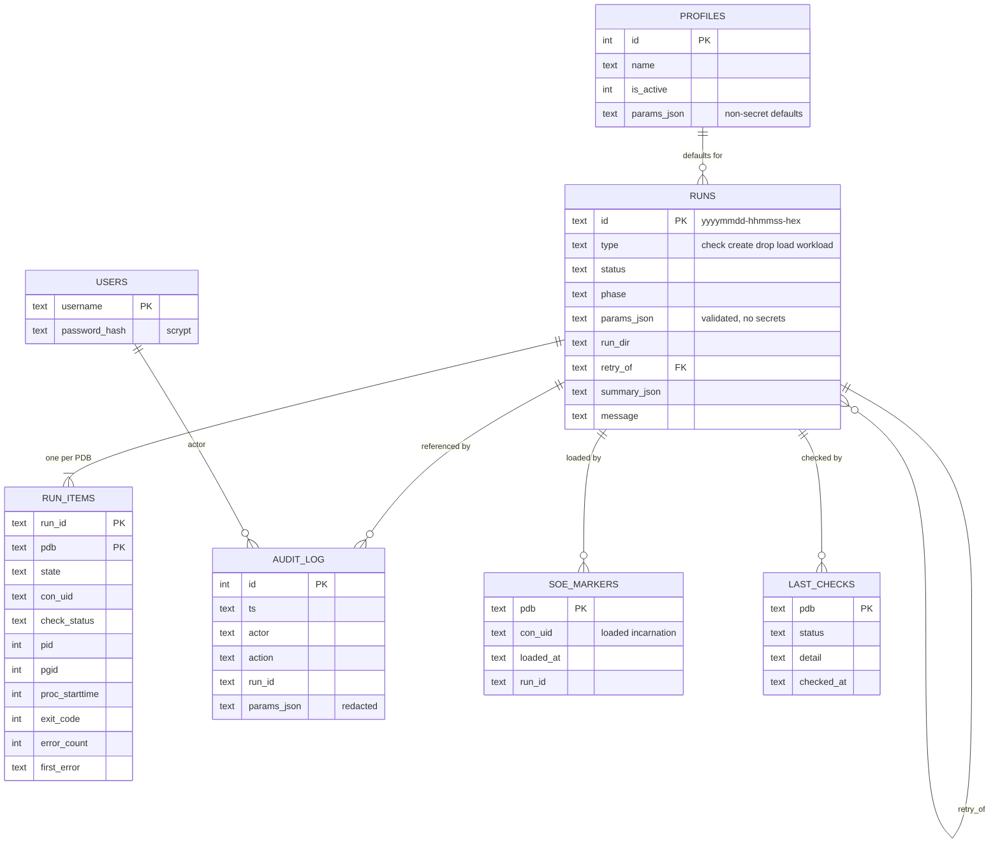

### 7.2 Data classification and location

| Data | Location | Persistence | Sensitivity |
|---|---|---|---|
| Profiles, run history, items, markers, last checks, audit | `~/.pdb-orchestrator/orchestrator.db` | durable, back up | internal |
| Login password hashes | same database, `users` | durable | confidential (scrypt hashes only) |
| Run artifacts | `<log dir>/run-<id>/` (dir 0700, files 0600) | durable until removed | internal |
| TLS key | `~/.pdb-orchestrator/tls/key.pem` (0600) | durable | secret |
| SOE, SYS, PDB admin, wallet passwords | process memory only | lifetime of the run / browser session | secret, never written |
| Login sessions, CSRF tokens | process memory only | until expiry or restart | secret |

### 7.3 Run directory layout

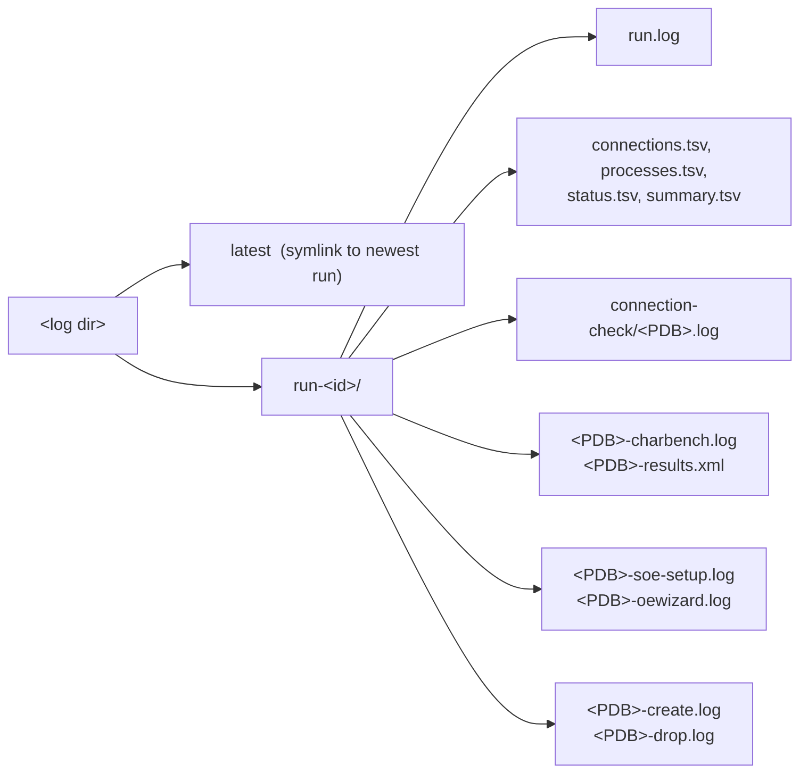

### 7.4 Information flow of one run

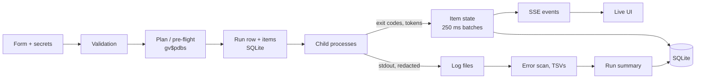

---

## 8. Runtime: key scenarios

### 8.1 Workload run: check, launch, monitor, summarise

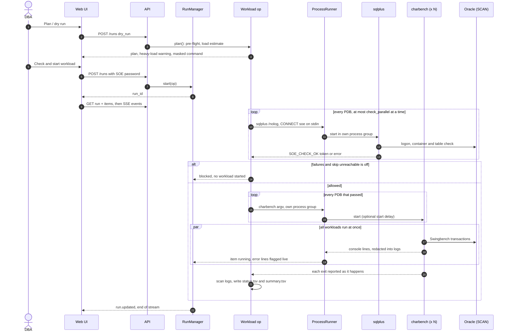

### 8.2 Create PDBs with drop-and-recreate (guarded)

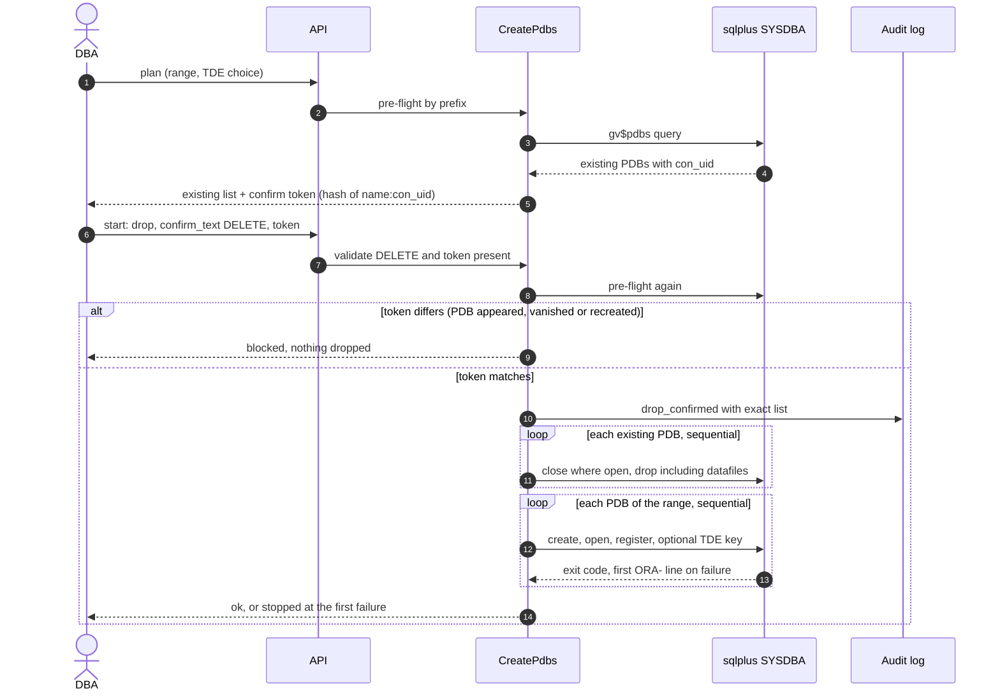

### 8.3 Remote SYSDBA logon and the session marker

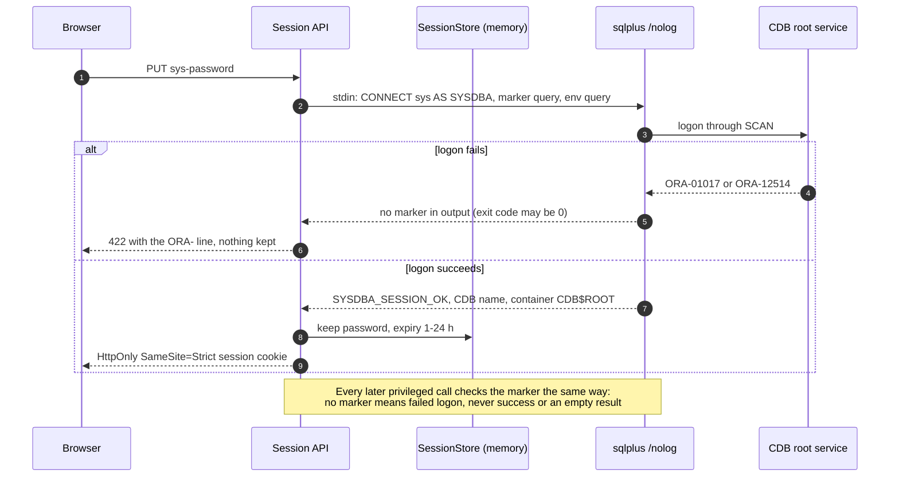

### 8.4 Live updates: snapshot, stream, reconnect

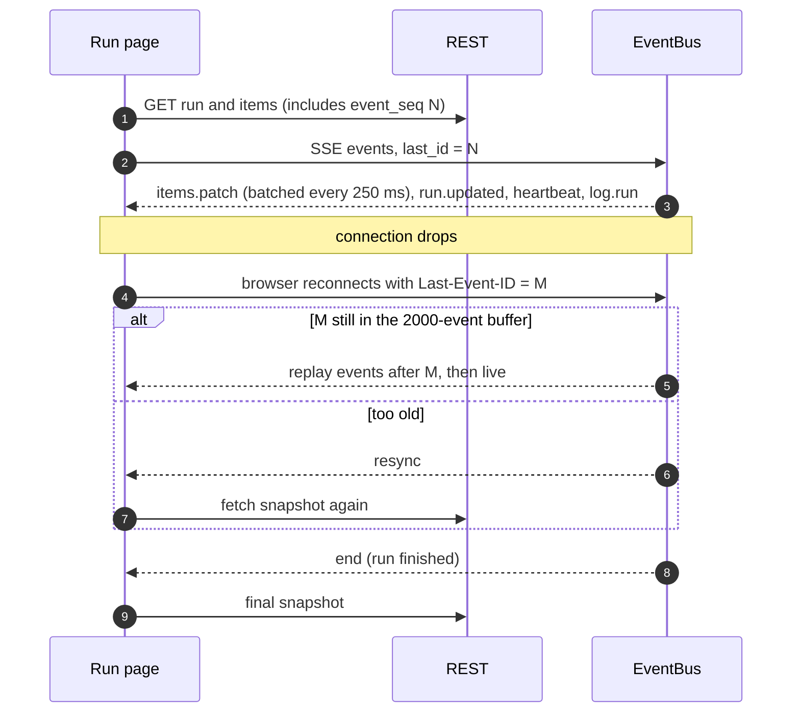

### 8.5 State machines

Run status:

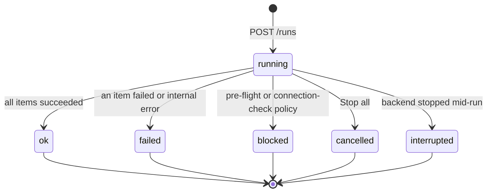

Item (PDB) state:

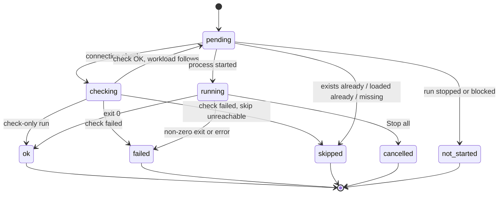

---

## 9. Process and concurrency model

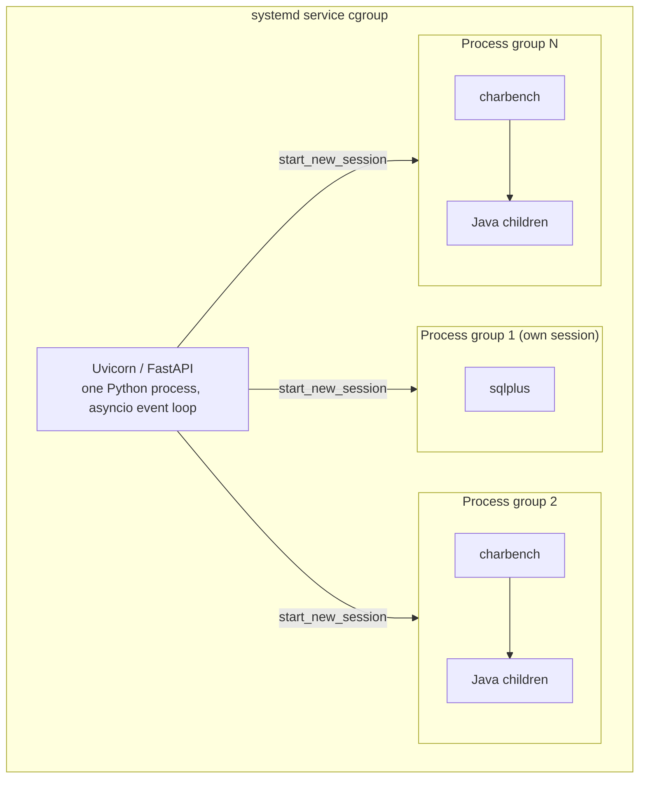

| Mechanism | Value | Purpose |
|---|---|---|
| Active runs | 1 per server | No conflicting operations (e.g. drop during workload); 409 for a second run |
| Connection checks in parallel | `check_parallel` (default 16) | Semaphore |
| SOE loads in parallel | `parallel` (default 1) | Sliding window; no new start after a failure unless keep-going |
| Workloads | all at once, optional start delay | All launched before any is awaited; completions reported in order of completion |
| Create / drop | strictly sequential | Same as the script; stop at first failure |
| Check timeout | `check_timeout`, then TERM, KILL after 5 s | Hung SQL*Net connects |
| Stop all / cancel | TERM to every group, KILL after 2 s | Reaches Java children too |
| State persistence | every 250 ms, one transaction | 250 completions cost a handful of writes and events |
| Heartbeat | 5 s (UI), 60 s (run log) | Liveness of long runs |

Stop sequence:

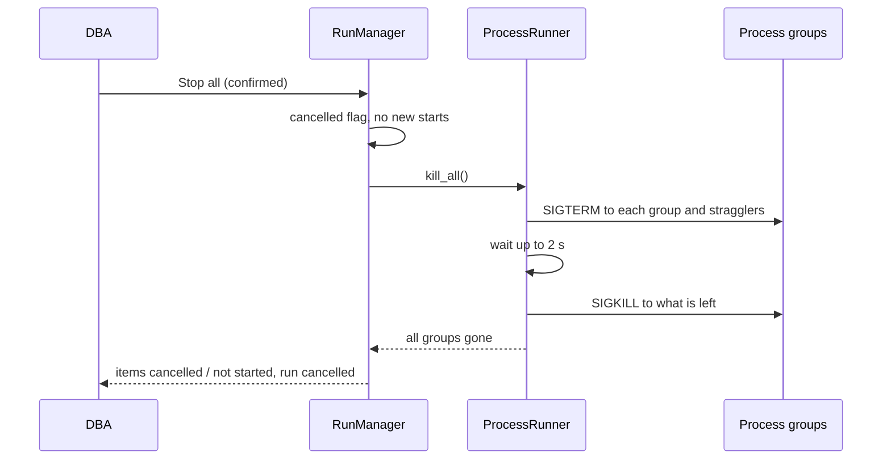

---

## 10. Security architecture

### 10.1 Controls

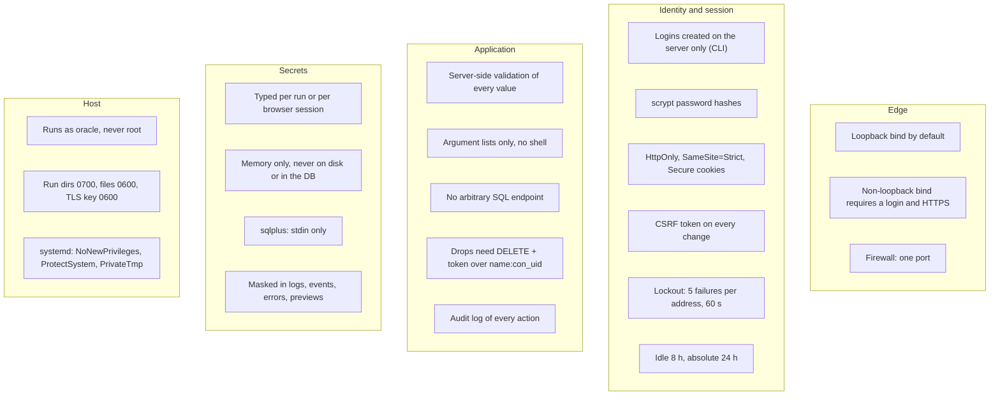

### 10.2 Where secrets travel

```mermaid
flowchart LR
    B["Browser password field"] -- "HTTPS or SSH tunnel" --> M["Server memory<br/>run secrets / SYS session"]
    M -- "stdin" --> SQ["sqlplus<br/>CONNECT ... or GRANT ... IDENTIFIED BY"]
    M -- "command-line argument" --> SW["oewizard -p / -dbap<br/>charbench -p"]
    SW -. "visible in ps on the app host<br/>while running" .-> PS["Process list"]
    SQ -- "output, redacted" --> LOG["Log files"]
    SW -- "output, redacted" --> LOG
    M -. "never" .-x DISK[("Database, files, audit")]
```

| Threat | Mitigation |
|---|---|
| Unauthenticated network access | Loopback by default; login + HTTPS required for network binds |
| Credential theft in transit | TLS or SSH tunnel; Secure cookies |
| CSRF from another site | SameSite=Strict cookies plus double-submit CSRF token |
| Password guessing | scrypt hashes, per-address lockout |
| Injection into SQL or commands | Strict validators, argument lists, no shell, no free SQL |
| Accidental destruction | Plan first, typed DELETE, token bound to the exact `name:con_uid` list, audit entry |
| Secret leakage | Memory-only secrets, stdin for sqlplus, redaction; tested by a suite that searches every file and response |
| Known residual risk | oewizard/charbench take passwords as arguments (visible in `ps` to users of the host) |

---

## 11. Resilience and recovery

```mermaid
flowchart TB
    START(["Backend starts"]) --> Q{"Runs still marked running?"}
    Q -- "no" --> READY(["Ready"])
    Q -- "yes" --> SCAN["Scan /proc once:<br/>pid + start time, process group members"]
    SCAN --> ALIVE{"Recorded process alive?"}
    ALIVE -- "yes" --> KEEP["Item stays running<br/>(not monitored)"]
    ALIVE -- "no" --> UNK["Item cancelled:<br/>ended while backend was down, result unknown"]
    KEEP --> INT["Run marked interrupted,<br/>logs kept"]
    UNK --> INT
    INT --> UIB["Run page: banner with live process groups"]
    UIB --> KL["Kill leftovers: TERM, KILL after 2 s, verified"]
    INT --> READY
```

| Failure | Behaviour |
|---|---|
| Browser closed or network drop | Run continues; page resyncs from REST and replays missed events |
| `systemctl stop/restart` | App stops the active run's process groups itself (cancelled), then exits |
| App crash under systemd | Restart after 5 s; remaining processes in the service cgroup are stopped; run interrupted |
| App killed outside systemd (`kill -9`) | Workloads keep running (charbench ignores the broken pipe); next start marks the run interrupted and lists them for Kill leftovers |
| Failed SYSDBA logon with exit code 0 | Detected by the missing session marker; reported, never treated as success |
| Load failure | Other loads finish; no new starts unless keep-going; Retry failed reruns only unfinished PDBs |
| Recreated PDB | `con_uid` differs from the marker, so it is loaded again |
| Host loss | Restore `orchestrator.db` from backup; run directories as needed |

---

## 12. Build, packaging and deployment pipeline

```mermaid
flowchart LR
    subgraph DEV["Development"]
        SRC["Source<br/>backend, frontend/src"]
        T["Tests<br/>pytest, vitest, Playwright"]
        UIB["npm run build<br/>frontend/dist + source hash"]
        GIT[("Git repository<br/>includes frontend/dist")]
        SRC --> T --> UIB --> GIT
    end
    subgraph BUILD["Build machine with internet"]
        BW["scripts/build-wheels.sh<br/>cp311 x86_64 wheels + lock"]
        BU["scripts/bundle.sh<br/>pdb-orchestrator-version.tgz"]
        BW --> BU
    end
    subgraph TARGET["Application host"]
        IO["scripts/install.sh<br/>online: pip, offline: wheels"]
        IS["scripts/install-service.sh<br/>unit + env file, enable, start"]
        RUN(["pdb-orchestrator.service"])
        IO --> IS --> RUN
    end
    GIT -- "git clone (online)" --> IO
    GIT --> BW
    BU -- "scp (offline)" --> IO
```

| Step | Who | Result |
|---|---|---|
| `scripts/install.sh` | app user | `venv/` with the backend and its dependencies (online or from bundled wheels) |
| `scripts/install-service.sh` | root | `/etc/systemd/system/pdb-orchestrator.service`, `/etc/pdb-orchestrator/orchestrator.env` (from the user's login environment; never overwritten), service enabled and started |
| `python -m app set-password` | app user | login for direct access |
| Upgrade | app user + root | `git pull` (or new bundle), `scripts/install.sh`, `systemctl restart`; database migrated automatically |

---

## 13. Quality and test architecture

```mermaid
flowchart TB
    subgraph SIM["Simulation mode, ORCH_MODE=simulate"]
        ST["Stub sqlplus, oewizard, charbench<br/>scenario.json: per-PDB failures, hangs,<br/>wrong container, ORA- errors, exit codes"]
        STATE[("Simulated CDB state<br/>PDBs, con_uid, open modes")]
        ST --- STATE
    end
    subgraph TESTS["Automated tests"]
        U["Unit: validators, builders, parsers,<br/>redaction, log scan"]
        G["Golden: SQL and argv compared with<br/>the reference scripts' text"]
        E["Engine: concurrency limits, failure policy,<br/>resume, timeouts, cancel without orphans"]
        A["API: validation, SSE replay, auth, CSRF,<br/>remote SYSDBA, restart recovery, kill -9"]
        L["Secret-leak suite over the whole lifecycle"]
        D["Deployment: service files, systemd-analyze"]
        F["Frontend: shared validation vectors,<br/>stale-build guard"]
        P["Browser (Playwright): 250-PDB runs, UI flows"]
    end
    TESTS --> SIM
```

---

## 14. Constraints and known limits

| Topic | Constraint |
|---|---|
| Scale | One CDB and one application host per installation; one active run at a time |
| Platform | Linux x86_64, Python 3.11, SQL*Plus on the host; Swingbench and Java where the app runs |
| Credentials | oewizard and charbench accept passwords only as arguments (visible in `ps`) |
| Results | Swingbench result XML is downloaded, not parsed; comparisons use exit codes, durations and log errors |
| Sessions | SYS password and logins live in memory; a restart requires entering them again |
| Crash | Console output of workloads that outlive a crash is lost; their result XML is still written |
| Resources | 250 charbench JVMs plus `PDBs x users` sessions load both hosts; the UI warns before heavy runs |
